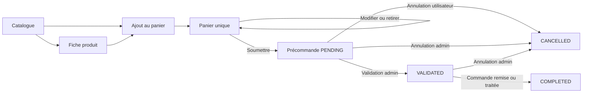
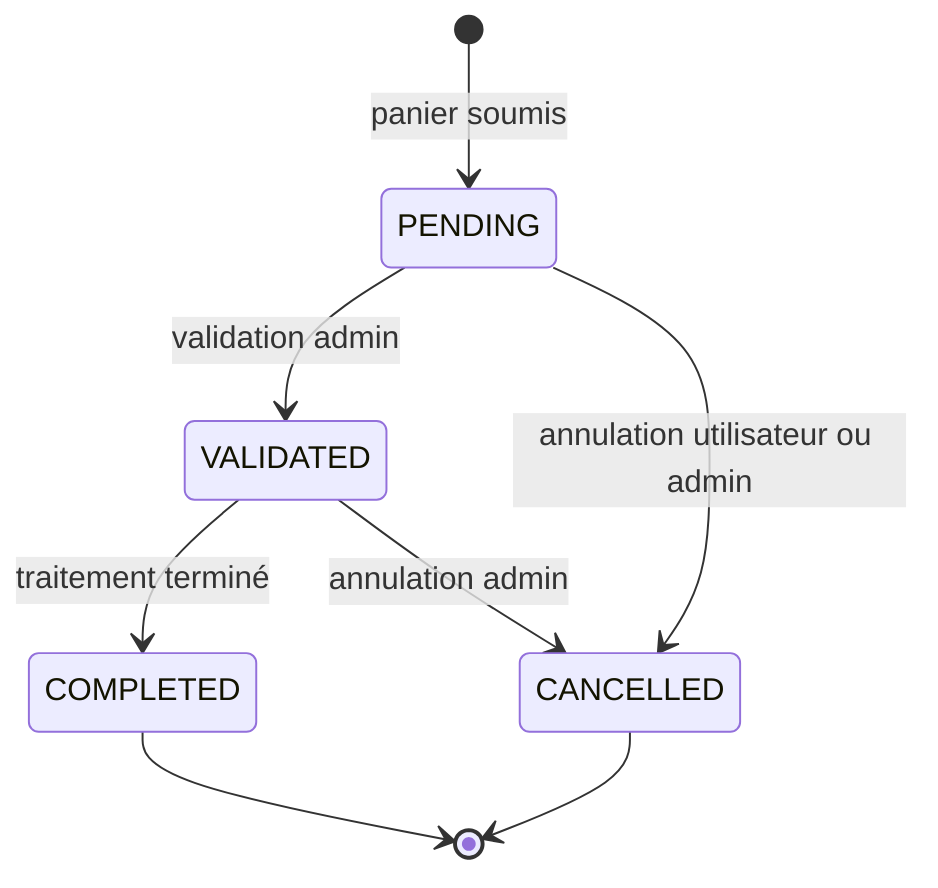

# Boutique — guide métier pour le front

Ce document décrit les parcours à implémenter dans les interfaces utilisateur et administration. La boutique est un système de réservation : elle ne gère ni paiement en ligne ni quantité de stock précise.

## Principes métier

- Un produit est destiné à avoir une ou plusieurs photos ordonnées. L'API autorise toutefois temporairement une liste vide pendant sa création ou son édition : le front public doit alors afficher un visuel de remplacement.
- Un produit possède également un nom, un prix exprimé en centimes d'euro, un état hors-stock et éventuellement un lien vers un article éditorial.
- Un utilisateur possède au maximum un panier. Le panier est conservé côté serveur.
- Soumettre le panier crée une précommande et vide le panier.
- Une précommande est traitée manuellement par un administrateur.
- Les informations d'un produit ne sont pas copiées dans la commande. Un changement de nom, de prix, de photos ou d'état est donc visible immédiatement dans les commandes existantes.
- La suppression d'un produit le retire automatiquement des paniers. Dans une précommande existante, sa ligne reste visible comme indisponible.
- Une annulation utilisateur ne crée pas de notification séparée. Elle devient visible dans la liste admin grâce au statut `CANCELLED`.

## Vue d'ensemble du parcours



## Parcours utilisateur

### 1. Catalogue

Écran recommandé : une grille ou une liste de produits alimentée par `GET /api/shop/products`.

Pour chaque produit, afficher au minimum :

- `name` ;
- `priceCents`, formaté en euros par le front ;
- la première photo de `photos`, la liste étant déjà triée par `displayOrder` ;
- un badge « Hors stock » lorsque `outOfStock` vaut `true`.

Un produit hors-stock reste visible, mais l'action d'ajout au panier doit être désactivée. Si `articleId` n'est pas nul, le front peut proposer un lien « En savoir plus » vers l'article correspondant.

### 2. Fiche produit

`GET /api/shop/products/{productId}` renvoie le même contrat enrichi de toutes les photos. Le carrousel doit respecter l'ordre reçu.

Exemple simplifié :

```json
{
  "id": "6c02831a-53d7-4a48-84ed-64d68c8ea591",
  "name": "Tote bag INSAstronaute",
  "priceCents": 1200,
  "outOfStock": false,
  "articleId": "ab4a7a25-ed2e-48dc-96a5-2e168787a726",
  "articleTitle": "La collection INSAstronaute",
  "photos": [
    {
      "id": "779eb78f-9185-41fc-861c-00a8aa163ca5",
      "url": "https://s3.example.com/public/shop/products/.../photo.webp",
      "displayOrder": 0
    }
  ]
}
```

### 3. Panier

`GET /api/shop/cart` renvoie toujours un panier exploitable. Avant la première modification, `id` vaut `null`, `lines` est vide et `totalPriceCents` vaut `0`.

Pour définir une quantité :

```http
PUT /api/shop/cart/items/{productId}
Content-Type: application/json

{"quantity": 2}
```

Une quantité à `0`, ou `DELETE /api/shop/cart/items/{productId}`, retire le produit. Une quantité négative est invalide. La réponse contient le panier complet mis à jour : le front doit remplacer son état local par cette réponse.

Chaque ligne expose `unitPriceCents` et `lineTotalCents`. Le total général est fourni par `totalPriceCents`; le front ne doit pas conserver un ancien calcul après une mutation.

Si un produit passe hors-stock alors qu'il est déjà dans le panier, la ligne reste affichée avec `outOfStock: true`. La soumission sera refusée tant que cette ligne n'aura pas été retirée. Si le produit est supprimé, la ligne disparaît automatiquement du panier à la prochaine lecture.

### 4. Soumission et suivi

`POST /api/shop/orders` transforme le panier en précommande `PENDING`, puis vide le panier. Le bouton de soumission doit être désactivé lorsque le panier est vide ou contient une ligne hors-stock.

`GET /api/shop/orders` renvoie les précommandes de l'utilisateur, de la plus récente à la plus ancienne.

Une commande contient son `status`, ses `lines`, son `totalPriceCents`, le booléen `hasUnavailableProducts` et ses dates `createdAt`/`updatedAt`. Le champ `user` est surtout utile à l'interface d'administration.

L'utilisateur peut annuler uniquement une commande `PENDING` :

```http
DELETE /api/shop/orders/{orderId}
```

Après succès (`204`), le front doit recharger la liste ou passer localement le statut à `CANCELLED`.

## Statuts et actions disponibles

| Statut | Libellé conseillé | Action utilisateur | Actions admin |
| --- | --- | --- | --- |
| `PENDING` | En attente de validation | Annuler | Valider, annuler |
| `VALIDATED` | Réservation validée | Aucune | Terminer, annuler |
| `COMPLETED` | Terminée | Aucune | Aucune |
| `CANCELLED` | Annulée | Aucune | Aucune |



Toute autre transition reçoit une réponse `400` avec le message `Transition de statut invalide.`

## Produit indisponible dans une précommande

Une ligne dont le produit a été supprimé est renvoyée ainsi :

```json
{
  "productId": null,
  "productName": null,
  "unitPriceCents": null,
  "productAvailable": false,
  "outOfStock": true,
  "photos": [],
  "quantity": 2,
  "lineTotalCents": null
}
```

Dans ce cas :

- `hasUnavailableProducts` vaut `true` sur la commande ;
- `totalPriceCents` vaut `null`, car le prix courant du produit n'existe plus ;
- le front doit afficher une alerte « Un produit de cette réservation n'est plus disponible » ;
- il ne faut pas afficher `0 €` à la place du total inconnu ;
- une commande `PENDING` peut toujours être annulée par l'utilisateur.

Un produit simplement passé hors-stock conserve `productAvailable: true` et ses informations, mais expose `outOfStock: true`.

## Parcours administrateur

### Catalogue

Les écrans admin utilisent `/api/admin/shop/products` :

- liste et détail ;
- création avec `name`, `priceCents`, `outOfStock` et `articleId` facultatif ;
- modification des mêmes champs ;
- suppression définitive ;
- bascule hors-stock via la modification du produit.

La suppression est définitive. Le front doit demander confirmation en rappelant qu'elle retirera le produit des paniers et le rendra indisponible dans les précommandes existantes.

### Photos

- `POST /api/admin/shop/products/{productId}/photos` en `multipart/form-data`, champ `file` ;
- `PUT /api/admin/shop/products/{productId}/photos/order` avec `{"photoIds":["...","..."]}` ;
- `DELETE /api/admin/shop/products/{productId}/photos/{photoId}`.

Formats autorisés : JPEG, PNG et WebP. Taille maximale : 15 Mo par photo. Après un upload, ajouter la photo renvoyée ou recharger le produit. Après un réordonnancement, remplacer la liste par celle renvoyée. Après une suppression (`204`), retirer la photo localement ou recharger le produit.

### Traitement des précommandes

`GET /api/admin/shop/orders` renvoie toutes les précommandes. Le paramètre facultatif `status` permet de filtrer, par exemple :

```http
GET /api/admin/shop/orders?status=PENDING
```

L'objet `user` contient `id`, `displayName` et `email`. L'écran de traitement doit signaler `hasUnavailableProducts` avant toute décision.

Pour changer le statut :

```http
PUT /api/admin/shop/orders/{orderId}/status
Content-Type: application/json

{"status": "VALIDATED"}
```

La réponse contient la commande mise à jour. Les boutons proposés doivent suivre strictement la table des statuts ci-dessus.

## Gestion des erreurs côté front

Toutes les mutations nécessitent le jeton CSRF dans l'en-tête `X-XSRF-TOKEN`. Une session authentifiée est requise ; les routes admin nécessitent le rôle `ADMIN`.

| HTTP | Cas courant | Comportement front conseillé |
| --- | --- | --- |
| `400` | Panier vide, produit hors-stock, quantité ou transition invalide | Afficher `message`, conserver l'écran et recharger le panier ou la commande si nécessaire |
| `401` | Session absente ou expirée | Rediriger vers la connexion |
| `403` | Action interdite ou commande appartenant à un autre utilisateur | Afficher une erreur d'autorisation |
| `404` | Produit, photo, commande ou utilisateur introuvable | Recharger la ressource ou revenir à la liste |

Messages métier actuellement renvoyés par le backend :

- `Le panier est vide.`
- `Produit indisponible.`
- `Le panier contient un produit indisponible.`
- `Cette précommande ne peut plus être annulée.`
- `Transition de statut invalide.`

Le front peut traduire ces messages en libellés plus contextuels, mais ne doit pas déduire un succès d'une réponse en erreur.

## Checklist d'intégration front

- Formater tous les champs `*Cents` en euros sans utiliser de flottants pour les calculs.
- Remplacer l'état du panier après chaque mutation.
- Désactiver l'ajout et la soumission pour les produits hors-stock.
- Afficher les statuts avec les actions autorisées uniquement.
- Traiter `totalPriceCents: null` comme un total inconnu.
- Signaler clairement `hasUnavailableProducts` et les lignes `productAvailable: false`.
- Inclure le jeton CSRF sur tous les `POST`, `PUT` et `DELETE`.
- Recharger les listes après une annulation ou un changement de statut.
